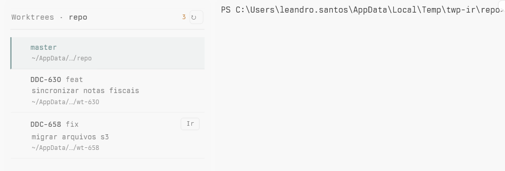

# Worktree Panel

A [Tern](https://stencil.so/tern) plugin: a panel pinned to the edge of every tab with the git worktrees of the focused repository and the state of the omp agents running in each one.



## Use

Toggle the panel with `Alt+Shift+E`, or the palette command **Worktrees: mostrar ou ocultar o painel**. `Alt+Shift+W` is left alone: tern-worktrees users often bind it to its new worktree picker.

When the panel is on, every tab of the window has its own copy, at the same edge and width, so switching tabs moves nothing. A new tab gets one as soon as it opens; a tab whose other panes all close loses its copy instead of keeping a lone panel. Clicking a panel hands the focus back to that tab's last used pane. Whether the panel is on is kept in the plugin's `kv.json`, like its side.

The panel sits on the left of the tab by default. **Worktrees: alternar lado do painel** moves every copy to the other side; the choice applies to every window and restart.

| Row | Meaning |
| --- | --- |
| Accent bar and title | The worktree of the focused pane |
| `Ir` | A pane is open in this worktree; without it, a click opens a tab there |
| Spinner and timer | An agent in it is working, for that long |
| `○` | An agent in it is idle |
| `·` | No agent in it |

A branch with a ticket key (`feat/DDC-630-sincronizar-notas-fiscais`) shows the key, the type and the rest of the name as a summary; other branch names show as they are.

A worktree whose agent waits for an answer moves to a card at the top, with the agent's last message and how long it has waited.

| Click | Does |
| --- | --- |
| A worktree card | Focuses the pane last used in that worktree, or its first pane, or opens a tab in it |
| Ctrl+click on a worktree card | Opens Tern's Git view of the worktree in a tab |
| A waiting card or `Responder` | Focuses that agent |
| `↻` | Reads the worktree list again |

The list is read again when the panel opens, when the focused pane moves to another repository, when a command finishes in a worktree, and on `↻`. Agent states are read every 3 seconds and when an agent finishes a turn.

## Limits

- The waiting time counts from when the panel first saw the state, because Tern does not report when an agent entered it.
- An agent in another Tern session shows in the panel, but its card cannot focus it; a toast says so.
- Creating and removing worktrees is not part of this plugin; [tern-worktrees](https://github.com/riicodespretty/tern-worktrees) does that.

## Install

```sh
tern plugin install github.com/mullerino/tern-worktree-panel
```

Needs `git` on the PATH. For development, link a checkout instead: `tern plugin link .`

## Develop

The tools are pinned in `.tools/` (not committed): Lune 0.11.0, StyLua 2.3.1, luau-lsp 1.70.1.

```sh
tern plugin types .
.tools/stylua --check model.luau window.luau test/
.tools/luau-lsp analyze --platform=standard --definitions=@tern=tern.d.luau model.luau window.luau
.tools/lune run test/model.test.luau
```

| File | Role |
| --- | --- |
| `model.luau` | Pure logic: worktree list parsing, branch names, path matching, agent state tracking, board rows |
| `window.luau` | The canvas panel, its placement and the Tern events |
| `test/model.test.luau` | Tests of `model.luau`, run with Lune |
| `designs/worktree-panel.pen` | The pen.dev prototype of the panel states |
| `docs/panel.png` | The screenshot above |

## License

MIT. See [LICENSE](LICENSE).
