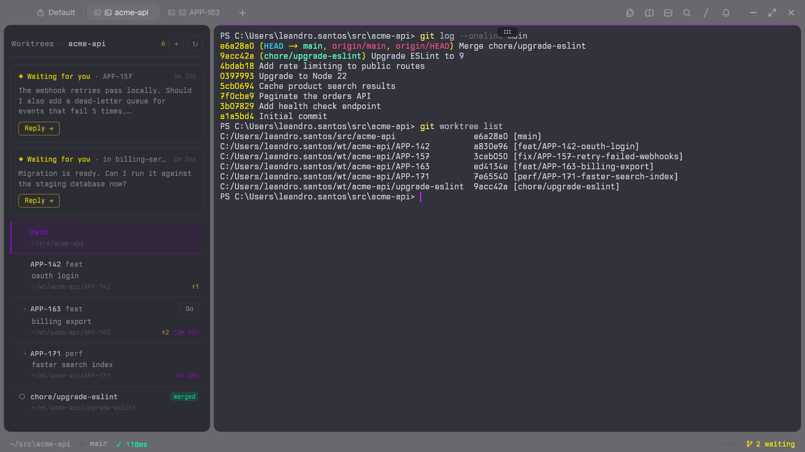

# Worktree Panel

A [Tern](https://stencil.so/tern) plugin: a panel pinned to the edge of every tab with the git worktrees of the focused repository and the state of the omp agents running in each one.



## Use

Toggle the panel with `Alt+Shift+E`, or the palette command **Worktrees: show or hide the panel**. `Alt+Shift+W` is left alone: tern-worktrees users often bind it to its new worktree picker.

When the panel is on, every tab of the window has its own copy, at the same edge and width, so switching tabs moves nothing. A new tab gets one as soon as it opens; a tab whose other panes all close loses its copy instead of keeping a lone panel. Clicking a panel hands the focus back to that tab's last used pane. Whether the panel is on is kept in the plugin's `kv.json`, like its side.

The panel sits on the left of the tab by default. **Worktrees: move the panel to the other side** moves every copy to the other side; the choice applies to every window and restart.


| Row | Meaning |
| --- | --- |
| Accent bar and title | The worktree of the focused pane |
| `Go` | A pane is open in this worktree; without it, a click opens a tab there |
| Spinner and timer | An agent in it is working, for that long |
| `○` | An agent in it is idle |
| `·` | No agent in it |
| `merged` | The branch is in the default branch of `origin` (`origin/HEAD`), squash merges included |
| `±3` | Uncommitted changes in the worktree, untracked files included |

A worktree that shows `merged` and no `±` is safe to remove. The check runs in the background after each list read, a few `git` calls per worktree one after another, and works offline against the last fetch: a branch counts as merged when every commit is on the base, or when merging it into the base would change nothing (squash merges). The trial merge writes its objects to a scratch folder in the plugin's data folder, deleted afterwards, never into the repository. A branch with no commits of its own is never `merged`.

A branch with a ticket key (`feat/APP-142-oauth-login`) shows the key, the type and the rest of the name as a summary; other branch names (`chore/upgrade-eslint`) show as they are.

A worktree whose agent waits for an answer moves to a card at the top, with the agent's last message and how long it has waited.

| Click | Does |
| --- | --- |
| A worktree card | Focuses the pane last used in that worktree, or its first pane, or opens a tab in it |
| Ctrl+click on a worktree card | Opens Tern's Git view of the worktree in a tab |
| A waiting card or `Reply` | Focuses that agent |
| `↻` | Reads the worktree list again |
| `+` | Asks for a branch name and creates a worktree on that new branch with `tern-wt create --new` |
| Right-click on a worktree card | New agent, Open tab, Git view, Copy path, Remove worktree (not on the main checkout) |

**New agent** asks for a task and starts an omp agent in a new tab in that worktree.

An agent waiting for an answer gets a card at the top even when it runs in another repository; the card names that folder. When an agent starts waiting in a tab you are not looking at, a toast shows where and its last message. With the status bar on, a `N waiting` segment counts the waiting agents; clicking it, or the palette command **Worktrees: go to the agent waiting longest**, focuses the one that has waited longest.

**Remove worktree** asks first, then runs `tern-wt remove`. It removes only worktrees tern-worktrees created; for one with uncommitted work it stops and offers **Force remove**, which discards that work. The branch follows tern-worktrees' teardown policy (by default it is deleted only when merged).

The list is read again when the panel opens, when the focused pane moves to another repository, when a command finishes in a worktree, and on `↻`. Agent states are read every 3 seconds and when an agent finishes a turn.

## Limits

- The waiting time counts from when the panel first saw the state, because Tern does not report when an agent entered it.
- An agent in another Tern session shows in the panel, but its card cannot focus it; a toast says so.
- Creating and removing worktrees need [tern-worktrees](https://github.com/riicodespretty/tern-worktrees) and its `tern-wt` CLI (`~/.local/bin/tern-wt`, or `tern-wt.cmd` on Windows, which `tern-wt setup` writes). Without it, `+` is hidden and Remove shows a toast.
- The `merged` check needs git 2.38 or newer (`git merge-tree --write-tree`).

## Install

```sh
tern plugin install github.com/mullerino/tern-worktree-panel
```

Needs `git` on the PATH. For development, link a checkout instead: `tern plugin link .`

## Develop

The tools are pinned in `.tools/` (not committed): Lune 0.11.0, StyLua 2.3.1, luau-lsp 1.70.1.

```sh
tern plugin types .
.tools/stylua --check model.luau window.luau test/
.tools/luau-lsp analyze --platform=standard --definitions=@tern=tern.d.luau model.luau window.luau
.tools/lune run test/model.test.luau
```

| File | Role |
| --- | --- |
| `model.luau` | Pure logic: worktree list parsing, branch names, path matching, agent state tracking, board rows |
| `window.luau` | The canvas panel, its placement and the Tern events |
| `test/model.test.luau` | Tests of `model.luau`, run with Lune |
| `designs/worktree-panel.pen` | The pen.dev prototype of the panel states |
| `docs/hero.png`, `docs/panel.png` | The screenshots above |

## License

MIT. See [LICENSE](LICENSE).
